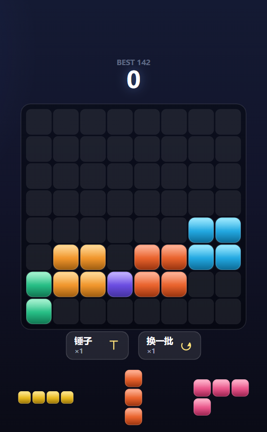

# 方寸 · fangcun

> 一个 38 KB 的单文件方块消除游戏。零依赖、零素材、纯 Canvas。
>
> A 38 KB single-file block puzzle. No dependencies, no assets, pure Canvas.

**在线玩**：<https://pengyuyan3d.github.io/fangcun/>



## 玩

双击 `index.html` 就能玩。也可以直接丢进任何静态托管（GitHub Pages 开箱可用）。

鼠标拖拽或触屏拖拽。`R` 重开。

## 规则

- 8×8 棋盘，底部三块随机形状，拖上去
- 填满整行或整列，那一排方块就整块碎开
- 连续消除累积连击，**三次没消除才断**
- 放不下的手牌会自动变暗；某行只剩一格时，那个空格会亮起来
- 棋盘快被塞满时，边框开始红色脉冲
- 锤子（敲掉一格）、换一批（重抽三块），每局各一次

计分参照主流方块消除：放置分 = 占用格数，消除分 = `10 × [行数×当前连击 + 行数×(行数+1)/2]`。

## 实现上值得一提的

- 单文件，**零外部请求**：没有图片、没有字体、没有音频文件、没有 CDN
- 所有图形是 Canvas 2D 现画的，所有音效是 WebAudio 现合成的
- 布局按窗口比例算，桌面横屏和手机竖屏各自排布
- 开局预置 14 格残局，每局不一样
- 发牌按块数加权，并随进度收紧：开局多小块，后期多大块

## 验证

```bash
node test.js
```

跑 24 项规则自检：消除、计分公式、连击宽容、复活、道具，以及六种界面状态的渲染冒烟。

无头模拟 300 局（贪心策略）的结果：

| 指标 | 数值 |
|---|---|
| 平均回合 | 153 |
| p10 / p50 / p90 | 53 / 137 / 265 |
| 贪心策略 vs 随机乱下 | 回合 11 倍、分数 83 倍 |

## 已知限制

- 只在桌面 Chrome 上验证过；真机触控、iOS Safari 未测
- 低端机在碎片飞散的 0.4 秒内可能掉帧
- 没有每日挑战、排行榜这类外围系统

## 说明

独立实现，未使用原作任何素材。玩法参考 Block Blast!（Hungry Studio），非官方，仅作学习与技术演示。

## License

MIT
